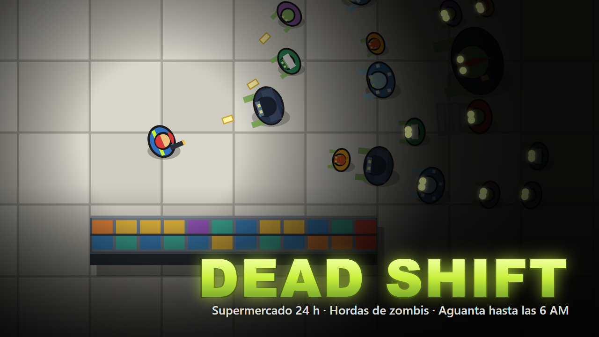

# Dead Shift



Survivor-like de zombis en un supermercado 24 h, para jugar en el navegador (PC y celular).

Jugar: <https://dannnyusssssss.github.io/dead-shift/> · Código: <https://github.com/Dannnyusssssss/dead-shift>

Eres Mati, el repositor del turno de noche. A las 10 PM se corta la luz y los clientes se levantan… distintos.
Sobrevive hasta las **6:00 AM** con lo que encuentres en las góndolas.

- Una partida dura **10 minutos reales** (el reloj del turno avanza de 10 PM a 6 AM).
- Sin instalación, sin backend y sin assets externos: todo se dibuja con Canvas 2D y el sonido se sintetiza con WebAudio.

## Cómo jugar

- **Dificultad:** se elige en el menú principal antes de jugar (Fácil, Medio o Difícil) y no cambia durante la
  partida. Fácil es el juego base. Medio y Difícil traen más zombis, con más vida y más daño, y menos munición y
  botiquines. En Difícil, además, cada tipo de zombi nuevo llega antes. El menú muestra la mejor hora y las victorias
  de cada dificultad.
- **Tus armas manuales:**
  - **Pistola de etiquetas:** tu arma principal. Tiene cargador y munición de reserva.
  - **Escoba:** el respaldo cuerpo a cuerpo; no gasta munición.
  - **Escopeta:** ráfaga de perdigones de corto alcance y mucho empuje, con cartuchos propios. Aparece como mejora desde
    el nivel 4 y está garantizada en el primer cofre del jefe.
  - Si un arma se queda sin munición, Mati cambia sola a la siguiente con munición (la escoba es la última). Cuando
    recoges munición, vuelve al arma que se había quedado seca.
- **Mods de pistola:** desde la Pistola nivel 3 pueden salir mejoras especiales (perforante, cargador extendido,
  incendiaria o con rebote). Como máximo 2 por partida.
- **Los zombis sueltan:**
  - Cupones (experiencia).
  - A veces, cajas de munición: verdes con balas y, si tienes la escopeta, rojas con cartuchos.
  - Los zombis élite, a veces, un **botiquín** (cura 25 % de la vida; si estás con la vida llena, queda en el suelo).
    El jefe siempre suelta uno.
  - Muy de vez en cuando, un **imán**: atrae todos los cupones del mapa.
- **Al subir de nivel** el juego se pausa y eliges 1 de 3 mejoras: un arma automática nueva, subir de nivel un arma
  o un pasivo. Tienes 3 "Cambiar opciones" por partida.
  - Armas automáticas: latas de conserva, bolsas de hielo, aerosol insecticida y microondas.
  - Pasivos: zapatillas, café, imán, chaleco, termo con sopa y calculadora.
- **El Gerente Zombi** (jefe) llega a las 2:00 AM y vuelve, más fuerte, a las 5:12 AM. Al vencerlo suelta un cofre
  con una mejora de arma gratis.
- **El Zombi Guardia** aparece desde las 3:36 AM: lleva casco y chaleco, no retrocede con los golpes y aparta a la
  horda a su paso. Las armas automáticas apenas le hacen daño (números grises): hay que apuntarle con la pistola, la
  escopeta o la escoba.
- **Frenesí de las 5 AM:** desde las 5:00 AM la horda corre más rápido y el hielo la frena la mitad. El reloj se
  pone rojo y los zombis tienen los ojos rojos.
- **Las góndolas son sólidas:** frenan a Mati, a los zombis y a las balas (la escoba barre por encima). Úsalas para
  cortar el paso a la horda.
- **Ganas** si llegas a las 6:00 AM con vida: amanece y los zombis se desmayan. Tu mejor hora y tus bajas totales
  quedan guardadas en el navegador (la mejor hora y las victorias, por dificultad).
- **Opciones del menú:** sonido, «Reducir movimiento» (quita el temblor de cámara y deja fijos los avisos que
  parpadean; también está en la pausa), «Controles», «Privacidad y créditos» y «Borrar datos guardados».
- **Menú «Controles»** (en el menú principal y en la pausa):
  - **Teclas y botones del mando:** pulsa el botón de una acción y después la tecla o el botón nuevo. Si ya lo usaba
    otra acción, las dos se intercambian. Esc cancela. Las flechas, Esc, Tab, 1-9 y F3 no se pueden cambiar.
    «Restablecer teclas y botones» vuelve a los de siempre.
  - **Campo de visión:** de 80 % a 130 %; con más campo ves más supermercado, todo un poco más chico. El HUD no cambia.
  - **Sensibilidad** de los joysticks táctiles y de los sticks del mando, de 1 a 5.
  - **Apuntado asistido:** la pistola y la escopeta apuntan solas al zombi más cercano a su alcance (la escoba no).
    Tú sigues disparando. El joystick de apuntado o el stick derecho del mando mandan sobre la asistencia. Las
    partidas con asistencia guardan récords y la pantalla final lo indica.
  - **Disparo:** «mantener pulsado» o «pulsar para empezar y parar».

## Controles

### PC

Teclas por defecto; las marcadas con \* se pueden cambiar en «Controles».

| Acción                 | Tecla                                                 |
| ---------------------- | ----------------------------------------------------- |
| Moverse                | WASD\* o flechas                                      |
| Apuntar                | Mouse                                                 |
| Disparar / golpear     | Clic izquierdo (mantenido) o Espacio\*                |
| Recargar               | R\*                                                   |
| Elegir arma            | 1 Pistola · 2 Escoba · 3 Escopeta                     |
| Cambiar de arma        | Q\* o rueda del mouse                                 |
| Pausa                  | Esc o P\* (también el botón ❚❚)                       |
| Silenciar              | M\*                                                   |
| Mostrar FPS y métricas | F3 (o la casilla en la pausa)                         |
| Elegir mejora          | 1 / 2 / 3, clic; la tecla de recargar cambia opciones |

Sin mouse (solo teclado), Mati apunta hacia donde camina y dispara con Espacio.

### Mando

Funciona con mandos que el navegador reconoce con la disposición estándar (Xbox, PlayStation y similares).

| Acción          | Botón por defecto                                                            |
| --------------- | ---------------------------------------------------------------------------- |
| Moverse         | Stick izquierdo o cruceta                                                    |
| Apuntar         | Stick derecho                                                                |
| Disparar        | RT / R2\*                                                                    |
| Recargar        | X / □\*                                                                      |
| Cambiar de arma | RB / R1\*                                                                    |
| Pausa           | Start / Options\*                                                            |
| Silenciar       | Back / Share\*                                                               |
| Menús           | Cruceta o stick izquierdo para moverse, A / ✕ para elegir, B / ○ para volver |

### Celular / tablet

- **Mitad izquierda:** joystick de movimiento (aparece donde apoyas el dedo).
- **Mitad derecha:** joystick de apuntado. Mientras lo empujas, Mati dispara hacia ese lado.
- **Botones:** "Cambiar arma" y "Recargar" abajo a la derecha, y pausa arriba a la derecha.
- La recarga también es automática al vaciar el cargador.
- El juego se pausa solo si cambias de app o de pestaña.
- La pausa tiene la casilla "Mostrar FPS y métricas".

## Desarrollo

Requisitos: Node.js 20 o superior.

```bash
npm install
npm run dev        # servidor de desarrollo (http://localhost:5173)
npm run build      # tsc --noEmit && vite build  -> dist/
npm run preview    # sirve dist/ para probar el build
npm run test       # tests de lógica (Vitest)
npm run lint       # ESLint
```

Para probar en el celular dentro de la misma red Wi-Fi: `npm run dev -- --host` y abre la dirección "Network" que aparece.

### Parámetros de depuración

Se agregan a la URL, por ejemplo `http://localhost:5173/?god&spawn=200`. Cualquiera de ellos salta el menú y muestra
FPS, CPU, zombis y bajas. Detalles, teclas, el dataset para pruebas y el reporte de balance en
[docs/DEBUG.md](docs/DEBUG.md).

| Parámetro      | Efecto                                                  |
| -------------- | ------------------------------------------------------- |
| `?debug`       | Solo las métricas                                       |
| `?god`         | Mati no pierde vida                                     |
| `?spawn=N`     | Empieza con una horda de N zombis                       |
| `?t=S`         | Adelanta el reloj S segundos (`?t=299`: llega el jefe)  |
| `?weapons=all` | Todas las armas (escopeta incluida) en nivel 5          |
| `?ammo=N`      | Cargador vacío y N balas de reserva (`0` = solo escoba) |
| `?difficulty=` | `easy`, `normal` o `hard`: juega en esa dificultad      |

### Estructura

```
src/
  core/     loop de timestep fijo, input, cámara, RNG con semilla, pools, rejilla espacial
  game/     estado y sistemas de la partida (sin DOM ni canvas)
  data/     armas, enemigos, mejoras, oleadas, sonidos, textos y constantes visuales
  render/   dibujo del mundo, HUD, partículas y números de daño
  ui/       menús y pantallas en DOM
  audio/    efectos sintetizados con WebAudio
  save/     récords y ajustes en localStorage
tests/      tests de lógica pura
```

Todo el contenido vive en `src/data/`: agregar un arma o un enemigo con un comportamiento existente es tocar un solo
archivo. Más detalle de las capas, el bucle y cómo se prueba en [docs/ARCHITECTURE.md](docs/ARCHITECTURE.md).

## Despliegue

`npm run build` genera `dist/`, una carpeta estática que funciona en cualquier hosting y en cualquier subruta
(`vite.config.ts` usa `base: './'`).

> Abrir `dist/index.html` con doble clic **no funciona**: los navegadores bloquean los módulos JavaScript fuera de un
> servidor (`file://`). Para probarlo en tu PC usa `npm run preview`.

### GitHub Pages (automático)

El workflow [`.github/workflows/deploy.yml`](.github/workflows/deploy.yml) compila, corre lint y tests, y publica
`dist/` en cada push a `main`.

1. En GitHub: **Settings → Pages → Build and deployment → Source: GitHub Actions** (una sola vez).
2. Haz push a `main`. El avance se ve en la pestaña **Actions**.
3. El juego queda en `https://<usuario>.github.io/<repositorio>/`.
   Para este repo: <https://dannnyusssssss.github.io/dead-shift/>.

También se puede lanzar a mano desde **Actions → Deploy to GitHub Pages → Run workflow**.

### itch.io

1. `npm run build`.
2. Comprime el **contenido** de `dist/` en un zip, no la carpeta: `index.html` tiene que quedar en la raíz del zip.
3. En itch.io: **Create new project**.
   - **Kind of project:** HTML.
   - Sube el zip y marca **This file will be played in the browser**.
4. En **Embed options**:
   - Tamaño sugerido: 1280 × 720.
   - Activa **Mobile friendly** (orientación automática) y **Fullscreen button**.

### Netlify

- Rápido: arrastra la carpeta `dist/` a <https://app.netlify.com/drop>.
- Conectado al repo: build command `npm run build`, publish directory `dist`.

### Vercel

Importa el repo. Vercel detecta Vite solo: build command `npm run build`, output directory `dist`.

## Privacidad

El juego no recolecta ningún dato: sin cuentas, analítica, anuncios ni cookies, y sin peticiones de red propias. Solo
guarda en tu navegador (`localStorage`, clave `deadshift:v1`) tus ajustes y récords, y puedes borrarlos con el botón
«Borrar datos guardados» del menú. El hosting puede registrar direcciones IP como cualquier servidor web. Detalle en
[docs/PRIVACY-INVENTORY.md](docs/PRIVACY-INVENTORY.md).

## Contenido

Edad orientativa **12+** (orientación propia, no una clasificación oficial): violencia de fantasía contra zombis
dibujados con formas simples, sin sangre realista (las bajas dejan manchas verdes).

## Licencia

Todos los derechos reservados. Titular: Danny Sivinta, 2026. El código se publica para consulta; no se concede licencia
de uso, copia, modificación ni distribución sin permiso escrito. Ver [LICENSE](LICENSE). El juego no incluye recursos
de terceros; las herramientas de desarrollo y sus licencias están en [docs/LICENSES.md](docs/LICENSES.md).

## Contacto

Danny Sivinta, Quito, Ecuador · cuartojuegos.contacto@gmail.com
